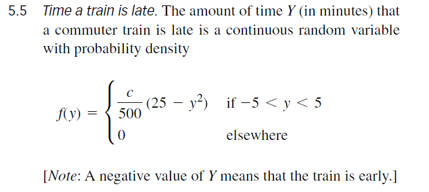

```{r setup, include=FALSE}
knitr::opts_chunk$set(echo = TRUE, fig.align = "center")
```

# Introduction

So far in the course we have shown you how to **USE** the dpq and r functions. In this problem you will need to create them for a particular random variable associated with a train being late to a station.



I named my versions `dmytrain`, `pmytrain`, `qmytrain` and `rmytrain` so they don't clash with the improved `dtrain`, `ptrain`, `qtrain` and `rtrain` I write at the end.

# Tasks

## Task 1

- Using the above density find "c". You should use $\int_{-\infty}^{\infty}f(t)dt = 1$

The density is 0 outside $(-5, 5)$, so only that piece of the integral counts:

$$
\begin{aligned}
1 &= \int_{-\infty}^{\infty} f(y)\,dy = \int_{-5}^{5} \frac{c}{500}\left(25 - y^2\right)dy \\
  &= \frac{c}{500}\left[25y - \frac{y^3}{3}\right]_{-5}^{5} \\
  &= \frac{c}{500}\left[\left(125 - \frac{125}{3}\right) - \left(-125 + \frac{125}{3}\right)\right] \\
  &= \frac{c}{500}\left(250 - \frac{250}{3}\right) = \frac{c}{500}\cdot\frac{500}{3} = \frac{c}{3}
\end{aligned}
$$

So $\frac{c}{3} = 1$, which gives $c = 3$ and

$$
f(y) = \frac{3}{500}\left(25 - y^2\right), \quad -5 < y < 5.
$$

Quick numerical check in R that it really integrates to 1:

```{r}
# integrate the density with c = 3 over its support, should be 1
integrate(function(y) 3/500 * (25 - y^2), lower = -5, upper = 5)
```

## Task 2

- In R create the density function `dmytrain(x)`, it must return a value for any $x \in \Re$

```{r}
# density of the train lateness: 3/500*(25 - x^2) on [-5, 5] and 0 everywhere else
dmytrain <- function(x){
  ifelse(x >= -5 & x <= 5, 3/500*(25 - x^2), 0)
}
```

- Plot the density over (-10,10)

```{r}
# curve() evaluates dmytrain on a grid of x values between -10 and 10
curve(dmytrain(x), from = -10, to = 10, n = 1000,
      lwd = 2, col = "darkgreen",
      xlab = "y (minutes late)", ylab = "f(y)",
      main = "Density of train lateness")
abline(h = 0, col = "grey")
```

- Evaluate `dmytrain(x = 0)`

```{r}
# should be 3/500*25 = 0.15, the peak of the density
dmytrain(x = 0)
```

## Task 3

- In R create the cumulative distribution function `pmytrain(q)`, it must return a value for any $q \in \Re$

Integrating the density from $-5$ up to $q$ gives

$$
F(q) = \int_{-5}^{q} \frac{3}{500}\left(25 - t^2\right)dt = \frac{75q - q^3 + 250}{500}, \quad -5 < q < 5
$$

```{r}
# cdf: 0 to the left of the support, 1 to the right, the cubic in between
pmytrain <- function(q){
  ifelse(q <= -5,
         0,
         ifelse(q >= 5,
                1,
                (75*q - q^3 + 250)/500))
}
```

- Plot the cumulative distribution function over (-10,10)

```{r}
# the cdf should climb from 0 to 1 between -5 and 5
curve(pmytrain(x), from = -10, to = 10, n = 1000,
      lwd = 2, col = "darkgreen",
      xlab = "q (minutes late)", ylab = "F(q)",
      main = "CDF of train lateness")
abline(h = c(0, 1), col = "grey", lty = 2)
```

- Evaluate `pmytrain(q = 0)`

```{r}
# the density is symmetric about 0 so this should be 0.5
pmytrain(q = 0)
```

## Task 4

- In R create the quantile function `qmytrain(p)` using the w-F Theorem

I'm using method 1: set $k(y) = F(y) - p$ and find the root of $k$ on $(-5, 5)$ with `uniroot()`, once for each component of `p`.

```{r}
qmytrain <- function(p){
  # probabilities have to be in [0, 1]
  if (any(p < 0 | p > 1)) stop("p must be between 0 and 1")

  # for one value of p, solve pmytrain(x) - p = 0 for x
  myroot <- function(p){
    k <- function(x){
      pmytrain(x) - p
    }
    stats::uniroot(k, interval = c(-5, 5), tol = 1e-8)$root
  }

  # map_vec runs myroot on each element of p and returns a vector
  purrr::map_vec(.x = p, .f = myroot)
}
```

- Evaluate `qmytrain(p = 0.75)`

```{r}
# 75% of the time the train is less than this many minutes late
qmytrain(p = 0.75)
```

- Evaluate `qmytrain(p = c(0.25,0.5,0.75))`

```{r}
# quartiles, they should be symmetric around 0 with the median at 0
qmytrain(p = c(0.25, 0.5, 0.75))
```

As a check, putting the quantiles back into the cdf should give the probabilities again:

```{r}
pmytrain(qmytrain(c(0.25, 0.5, 0.75)))
```

## Task 5

- In R create the random sample function `rmytrain(n)` using the w-F Theorem with w from `uniform(0,1)`

```{r}
# make n uniform(0,1) values and push them through the quantile function
rmytrain <- function(n){
  r <- runif(n, 0, 1)
  qmytrain(r)
}
```

- Make a random sample of size $n=10000$ and use it to make a relative frequency histogram with the train density overlain.

```{r}
set.seed(4753) # so the sample is the same every time I knit

samp <- rmytrain(10000)

# freq = FALSE puts density on the y axis so it lines up with dmytrain
hist(samp, freq = FALSE, breaks = 40,
     col = "lightgreen", border = "white",
     xlim = c(-6, 6),
     xlab = "y (minutes late)",
     main = "10000 simulated train delays")
curve(dmytrain(x), from = -6, to = 6, n = 1000,
      add = TRUE, lwd = 2, col = "darkgreen")
legend("topright", legend = c("sample", "density"),
       fill = c("lightgreen", NA), border = c("white", NA),
       lty = c(NA, 1), lwd = c(NA, 2), col = c(NA, "darkgreen"), bty = "n")
```

The histogram follows the curve really closely, so `rmytrain` is producing values from the right distribution. The sample mean and variance should also be close to the true values $E(Y) = 0$ and $V(Y) = 5$:

```{r}
mean(samp)
var(samp)
```


# New and Useful: better train functions

The `my` functions above work, but they are pretty bare. They don't check their inputs, `qmytrain` calls `uniroot()` once for every probability (slow for big samples), and they only return numbers. Here are improved versions `dtrain`, `ptrain`, `qtrain` and `rtrain` that:

- check their inputs and give clear error messages,
- use an exact formula for the quantile instead of root finding,
- draw a `ggplot2` plot with the relevant area shaded and the important values marked,
- return an object holding the numbers plus useful summaries (mean, variance, tail probabilities), which prints nicely.

## The exact quantile

Setting $F(q) = p$ and multiplying by 500 gives the cubic

$$
q^3 - 75q + (500p - 250) = 0 .
$$

This cubic always has three real roots, so I can use the trig solution. Only one root lands inside $(-5, 5)$:

$$
q = 10\cos\left(\frac{\arccos(1 - 2p) - 2\pi}{3}\right), \quad 0 \le p \le 1 .
$$

Checking the ends: $p = 0$ gives $10\cos\left(-\frac{2\pi}{3}\right) = -5$, $p = \frac{1}{2}$ gives $10\cos\left(-\frac{\pi}{2}\right) = 0$, and $p = 1$ gives $10\cos\left(-\frac{\pi}{3}\right) = 5$.

## The functions

```{r, message=FALSE}
library(ggplot2)

# matcha green colours used in all the plots
matcha <- c(dark = "#4F6F3A", mid = "#7BA05B", light = "#C5D8A4", cream = "#F4F1E6")

# true summaries of the train distribution (worked out by hand: E(Y) = 0, V(Y) = 5)
train_moments <- list(mean = 0, variance = 5, sd = sqrt(5), median = 0, mode = 0)

# helper: stop with a clear message if x is not a usable numeric vector
check_numeric <- function(x, name){
  if (is.logical(x) && all(is.na(x))) return(invisible(TRUE))   # a plain NA is fine, it just gives NA back
  if (!is.numeric(x)) stop("`", name, "` must be numeric, not ", class(x)[1], call. = FALSE)
  if (length(x) == 0) stop("`", name, "` must have at least one value", call. = FALSE)
  invisible(TRUE)
}

# helper: the density curve that every plot starts from
train_base_plot <- function(xlim = c(-7, 7)){
  grid <- data.frame(x = seq(xlim[1], xlim[2], length.out = 600))
  grid$y <- ifelse(grid$x > -5 & grid$x < 5, 3/500*(25 - grid$x^2), 0)
  ggplot(grid, aes(x = .data$x, y = .data$y)) +
    geom_line(colour = matcha["dark"], linewidth = 1.1) +
    labs(x = "y (minutes late)", y = "f(y)") +
    theme_minimal(base_size = 12) +
    theme(panel.background = element_rect(fill = matcha["cream"], colour = NA),
          plot.title = element_text(face = "bold", colour = matcha["dark"]))
}

# helper: shade the density between a and b
shade <- function(a, b, fill = matcha["mid"]){
  a <- max(a, -5); b <- min(b, 5)
  if (a >= b) return(NULL)
  s <- data.frame(x = seq(a, b, length.out = 300))
  s$y <- 3/500*(25 - s$x^2)
  geom_area(data = s, aes(x = .data$x, y = .data$y), fill = fill, alpha = 0.6)
}

# ---- density ----
dtrain <- function(x, plot = TRUE){
  check_numeric(x, "x")
  d <- ifelse(x > -5 & x < 5, 3/500*(25 - x^2), 0)

  out <- c(list(type = "density", input = x, value = d), train_moments)
  if (plot){
    pts <- data.frame(x = x, y = d)[is.finite(x), ]
    out$plot <- train_base_plot(range(c(-7, 7, pts$x))) +
      geom_segment(data = pts, aes(x = .data$x, xend = .data$x, y = 0, yend = .data$y),
                   colour = matcha["mid"], linetype = 2) +
      geom_point(data = pts, aes(x = .data$x, y = .data$y), colour = matcha["dark"], size = 3) +
      labs(title = "Train lateness density f(y)",
           subtitle = "points show f(x) at the values you gave")
  }
  structure(out, class = "train")
}

# ---- cdf ----
ptrain <- function(q, lower.tail = TRUE, plot = TRUE){
  check_numeric(q, "q")
  qc <- pmin(pmax(q, -5), 5)                 # clamp to the support so +-Inf works too
  lower <- (75*qc - qc^3 + 250)/500
  upper <- 1 - lower

  out <- c(list(type = "cdf", input = q,
                value = if (lower.tail) lower else upper,
                lower.tail = lower.tail, lower = lower, upper = upper),
           train_moments)
  if (plot){
    # shade the area for the first finite q
    i <- which(is.finite(q))[1]
    g <- train_base_plot()
    if (!is.na(i)){
      g <- g + (if (lower.tail) shade(-5, q[i]) else shade(q[i], 5)) +
        geom_vline(xintercept = q[i], colour = matcha["dark"], linetype = 2)
    }
    out$plot <- g +
      labs(title = if (lower.tail) "P(Y <= q)" else "P(Y > q)",
           subtitle = if (is.na(i)) NULL else
             sprintf("shaded area for q = %.3f is %.4f", q[i], out$value[i]))
  }
  structure(out, class = "train")
}

# ---- quantile (exact, no root finding) ----
qtrain <- function(p, lower.tail = TRUE, plot = TRUE){
  check_numeric(p, "p")
  if (any(p < 0 | p > 1, na.rm = TRUE)) stop("p must be between 0 and 1", call. = FALSE)
  pl <- if (lower.tail) p else 1 - p
  qv <- 10*cos((acos(1 - 2*pl) - 2*pi)/3)

  out <- c(list(type = "quantile", input = p, value = qv, lower.tail = lower.tail),
           train_moments)
  if (plot){
    ok <- qv[!is.na(qv)]
    g <- train_base_plot()
    if (length(ok) == 1){
      # one quantile: shade the tail that has probability p
      g <- g + (if (lower.tail) shade(-5, ok) else shade(ok, 5))
    } else if (length(ok) > 1){
      # several quantiles: shade both critical tails and the middle lightly
      g <- g + shade(min(ok), max(ok), fill = matcha["light"]) +
        shade(-5, min(ok)) + shade(max(ok), 5)
    }
    out$plot <- g +
      geom_vline(xintercept = ok, colour = matcha["dark"], linetype = 2) +
      annotate("label", x = ok, y = 0.165, label = sprintf("%.3f", ok),
               colour = matcha["dark"], size = 3.5) +
      coord_cartesian(ylim = c(0, 0.175)) +
      labs(title = "Train lateness quantiles",
           subtitle = "dashed lines are the quantiles, shaded areas are the tails")
  }
  structure(out, class = "train")
}

# ---- random sample ----
rtrain <- function(n, plot = TRUE){
  if (!is.numeric(n) || length(n) != 1 || is.na(n) || n < 1 || n != round(n))
    stop("n must be a single whole number >= 1", call. = FALSE)
  s <- qtrain(runif(n), plot = FALSE)$value
  sv <- if (n > 1) var(s) else NA_real_

  out <- c(list(type = "sample", input = n, value = s,
                sample_mean = mean(s), sample_variance = sv),
           train_moments)
  if (plot){
    out$plot <- train_base_plot() +
      geom_histogram(data = data.frame(x = s), aes(x = .data$x, y = after_stat(density)),
                     inherit.aes = FALSE, binwidth = 0.25, boundary = -5,
                     fill = matcha["light"], colour = "white") +
      geom_line(colour = matcha["dark"], linewidth = 1.1) +   # redraw the curve on top
      labs(title = sprintf("Random sample of n = %d", n),
           subtitle = sprintf("sample mean %.3f (true 0), sample variance %.3f (true 5)",
                              mean(s), sv))
  }
  structure(out, class = "train")
}

# print method: show the numbers, the summaries, then the plot
print.train <- function(x, ...){
  cat("Train lateness distribution:", x$type, "\n")
  if (x$type == "sample"){
    cat("  n =", x$input, "\n  first values:", format(head(x$value, 6), digits = 4), "\n")
    cat(sprintf("  sample mean %.4f, sample variance %.4f\n", x$sample_mean, x$sample_variance))
  } else {
    tab <- data.frame(x$input, x$value)
    names(tab) <- c(switch(x$type, density = "x", cdf = "q", quantile = "p"), "value")
    print(tab, row.names = FALSE)
  }
  if (x$type == "cdf")
    cat(sprintf("  lower tail P(Y <= q): %s\n  upper tail P(Y > q):  %s\n",
                paste(round(x$lower, 4), collapse = ", "),
                paste(round(x$upper, 4), collapse = ", ")))
  cat(sprintf("  E(Y) = %g, V(Y) = %g, SD(Y) = %.4f\n", x$mean, x$variance, x$sd))
  if (!is.null(x$plot)) print(x$plot)
  invisible(x)
}
```

## Trying them out

Density at a few points, including one outside the support:

```{r}
dtrain(c(-6, -2.5, 0, 2.5))
```

Probability the train is at most 2 minutes late, then the probability it is more than 2 minutes late:

```{r}
ptrain(2)
ptrain(2, lower.tail = FALSE)$value
```

The critical values that cut off 2.5% in each tail, so the middle 95% of delays fall between them:

```{r}
qtrain(c(0.025, 0.975))
```

A random sample of 10000, like Task 5:

```{r}
set.seed(4753)
r <- rtrain(10000)
r
```

## Checking against the original functions

The new functions should give the same answers as the `my` versions:

```{r}
x <- seq(-10, 10, by = 0.01)
p <- seq(0, 1, by = 0.001)
all.equal(dtrain(x, plot = FALSE)$value, dmytrain(x))
all.equal(ptrain(x, plot = FALSE)$value, pmytrain(x))
max(abs(qtrain(p, plot = FALSE)$value - qmytrain(p)))   # tiny, just uniroot's tolerance
```

The exact formula is also a lot faster than calling `uniroot()` over and over:

```{r}
pp <- runif(10000)
system.time(qmytrain(pp))
system.time(qtrain(pp, plot = FALSE))
```

And the input checks catch bad input with a clear message:

```{r, error=TRUE}
qtrain(1.5)
dtrain("five")
rtrain(-3)
rtrain(2.5)
```
